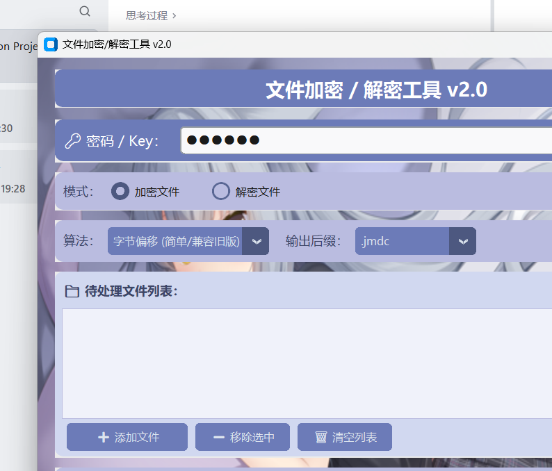

# 文件加密 / 解密工具

Python + CustomTkinter 写的一个文件加密小工具，支持多文件批量处理。

## 功能

- 三种加密算法：
  - 字节偏移 — 最简单的加法偏移，兼容旧版 `.jmdc` 文件
  - XOR 循环异或 — 对称加密，速度快
  - AES-256-CBC — 标准安全加密，推荐敏感文件用这个
- 批量处理，一次选多个文件一起跑
- 可选自定义输出目录，默认输出到源文件同目录
- 解密时自动识别文件用的算法，不用手动选
- 能解密旧版 v0.1 / v0.3 生成的 `.jmdc` 文件
- 自动保留原始扩展名，同名文件不会被覆盖

## 下载

去 [Releases](../../releases) 下载最新版，解压双击 `文件加密解密工具.exe` 就能用。

## 截图



## 从源码跑

```bash
git clone https://github.com/whr936689/simple_file_encryption_decryption_tool.git
cd simple_file_encryption_decryption_tool
pip install pycryptodome customtkinter pillow
python gui_version.py
```

## 打包

```bash
pip install pyinstaller
pyinstaller --noconfirm --windowed --onefile \
  --name "文件加密解密工具" \
  --add-data "background_1.png;." \
  gui_version.py
```

## 用法

加密文件：

1. 输入密码
2. 选「加密文件」模式
3. 选算法（敏感文件选 AES-256-CBC）
4. 选输出后缀，默认 `.jmdc`
5. 添加要加密的文件，可以多选
6. 点开始

加密完会在原文件旁边生成一个 `.jmdc` 文件。

解密文件：

1. 输入加密时用的密码
2. 切到「解密文件」
3. 选 `.jmdc` / `.enc` 文件，可多选
4. 点开始

解密时算法会自动识别，不用手动选。

## 算法对比

| 算法 | 安全性 | 速度 |
|------|--------|------|
| 字节偏移 | 低 | 最快 |
| XOR 循环 | 中等 | 快 |
| AES-256-CBC | 高 | 适中 |

字节偏移算法很弱，不要拿它加密真正敏感的东西。

## 文件格式

新版加密格式（JMD1 魔数）：
```
[4字节 "JMD1"][2字节算法号][4字节扩展名长度][扩展名][加密数据]
```

旧版格式（解密时自动识别）：
```
[4字节扩展名长度][扩展名][offset加密数据]
```

## 项目结构

```
simple_file_encryption_decryption_tool/
├── gui_version.py      # GUI 入口
├── crypto_core.py      # 加密核心
├── main.py             # 业务逻辑
├── file_cz.py          # 文件读写
├── background_1.png    # 背景图
└── README.md
```

## 注意

- 密码丢了找不回来，自己记好
- AES 模式密码最好 8 位以上
- 旧版 `.jmdc` 文件只有字节偏移算法，新版加不进去

## License

MIT
